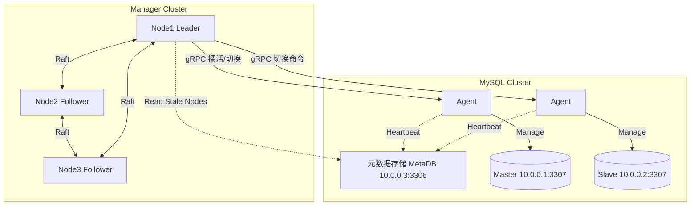

# Go-Helix (High Availability Manager)

Go-Helix 是基于 Go 的轻量级、高可用数据库管理与自动故障切换系统，支持多种数据库引擎（当前内置 MySQL），提供快速、可靠的故障检测与主从切换。

> **文档导航**
> - 本文件（README）：架构、核心机制、快速开始、运维操作、HTTP API、数据模型、账户权限、配置参考、参数全表。
> - [PLUGIN_GUIDE.md](PLUGIN_GUIDE.md)：如何为 Agent 新增插件（步骤、模板、参数契约、共享连接池）。

> **示例环境地址约定**（全文统一）
> | 角色 | 地址 |
> |------|------|
> | 元数据库 MetaDB | `10.0.0.3:3306` |
> | Master（受管 MySQL） | `10.0.0.1:3307`（Agent gRPC `23307`） |
> | Slave（受管 MySQL） | `10.0.0.2:3307`（Agent gRPC `23307`） |
> | 业务 VIP | `10.0.0.10` |

---

## 目录

1. [架构概览](#1-架构概览)
2. [核心机制与实现](#2-核心机制与实现)
3. [快速开始](#3-快速开始)
4. [运维操作](#4-运维操作)
5. [HTTP API 参考](#5-http-api-参考)
6. [数据模型](#6-数据模型)
7. [账户与权限](#7-账户与权限)
8. [新增一种数据库支持](#8-新增一种数据库支持)
9. [配置参考](#9-配置参考)
10. [日志系统](#10-日志系统)
11. [系统参数一览](#11-系统参数一览)
12. [附录：验收 / 选型 / 实现状态](#12-附录验收--选型--实现状态)
13. [License 协议](#13-license-协议)

---

## 1. 架构概览

系统采用 **Manager-Agent** 架构，Manager 自身通过 **Raft** 保证高可用。



| 组件 | 二进制 | 职责 |
|------|--------|------|
| **Agent** | `cmd/agent` | 随数据库部署：管理本地实例、上报心跳、执行 Manager 下发操作 |
| **Manager** | `cmd/manager` | 3 节点 Raft 集群：Leader 负责故障检测、选主与切换，暴露 HTTP API |

**通信协议**：Manager↔Agent 走 gRPC（探活/状态/操作/插件/流式命令/文件拉取）；Agent、Manager 与元数据库直连；Manager 间走 Raft；运维/浏览器走 HTTP REST / NDJSON。

**代码结构**：`cmd/{agent,manager}` 入口；`pkg/agent`（gRPC 服务、`backend/` 实例后端、`plugins/` 插件、binlog 救援、流式命令/文件拉取）；`pkg/manager`（`http/` API、`monitor/` 检测调度、`web/` 控制台、`switchlog/`）；`pkg/logic`（切换决策与执行框架，MySQL 实现在 `mysql/`）；`pkg/db`（`drivers/` 方言、`ops/` 健康检查）；`pkg/datacenter`（门面 `Client`、`MetaStore` 接口与 MySQL/SQLite/内存三后端）；另有 `pkg/config`、`pkg/raft`、`pkg/metrics`、`pkg/notify`、`pkg/logging`、`pkg/proto`。

**关键特性**：元数据多后端（MySQL/SQLite/内存，行为一致）；流式命令执行（白名单、逐行回传、断连即杀）；安全文件拉取（目录 jail、文件名/SHA256 校验、SSRF 防护、原子改名、限速）；集群优先级 P0–P3 与 Manager 分层；业务端点（VIP/域名）经语言无关 Hook 联动；多渠道告警（邮件/企业微信/钉钉/飞书）；Fencing 防脑裂；Raft FSM 持久化切换记录与审计日志（含来源 IP 追踪）；免鉴权 `/health` `/ready` `/metrics`。

---

## 2. 核心机制与实现

**目标**：为主从复制集群提供自动故障检测、选主、切换与数据补齐，主节点故障时自动恢复，尽量减少数据丢失与中断。

### 2.1 拓扑自动发现

不人工维护主从关系，而由复制边自动还原，DataCenter 分配稳定集群名。

- **复制边**：Agent 经 `SHOW REPLICA STATUS` 读上游；`Master_Host/Port` 非空为 slave，为空为 master。
- **上报**：`ip/port/agent_port`、`master_host/port`、`role`、`gtid_executed`、`binlog_file/pos`、半同步、延迟。
- **集群归属**（未显式配置 `cluster_name` 时）：本机已注册 → 加入上游集群 → 加入指向我的下游集群 → 分配新集群名（`cluster1`、`cluster2`…）。
- **地址一致性**：Slave 配置的上游地址形态须与 Master 上报的 `ip` 一致（统一 IP 或统一可解析主机名）。

### 2.2 Agent：数据库代理

- **多实例管理**：一个 Agent 管理同机多实例，各自绑定 gRPC、独立心跳（`agent.instances[]`）。
- **自动发现（生产默认）**：`instances` 为空时经 `netstat/ss` 扫 mysqld 端口；类型由 `auto_discover_type`（默认 mysql）；用 `default_db_user`（app_user）探活（必须配置）；复制账户取 `replication_db_user`（repl），切换/GTID 用 `manager_db_user`（manager）；Agent 端口由方言推导（MySQL：`db_port + 20000`）；`report_ip` 取主网卡非 loopback IPv4。
- **手动配置（调试）**：在 `instances[]` 显式定义，实例级 `db.*` 可覆盖三类账户。

**gRPC 服务（共 12 个方法）**

| RPC | 类型 | 功能 |
|-----|------|------|
| `Ping` | 一元 | MySQL 存活探测 |
| `GetStatus` | 一元 | 中立状态：`read_only`、`receiver/applier_running`、`upstream_host/port`、`semi_sync_master` + 类型特有键 |
| `ExecuteOperation` | 一元 | `StopSlave/StartSlave/ResetSlave/ChangeMaster/SetReadOnly/EnableSemiSyncMaster/KillConnections/WaitCatchup` |
| `ExecuteShell` | 一元 | 白名单命令 df/uptime/echo/ping/date/free |
| `ExecutePlugin` | 一元 | 调用插件（如 gtid_sync），见 [PLUGIN_GUIDE.md](PLUGIN_GUIDE.md) |
| `SSHCheck` / `GetDiskStatus` / `KillProcess` | 一元 | TCP 可达性 / 磁盘使用率 / 终止进程（MySQL KILL 或 OS kill） |
| `ExecStream` | 服务端流 | 白名单命令逐行回传，末行 `exit_code` |
| `FetchFile` | 服务端流 | 从源 URL 安全下载到受限根目录 |
| `StreamBinlogTail` | 服务端流 | 本地读 binlog 尾部按 MHA 格式回传，mysqld 死了也能读 |
| `ApplyBinlogRescue` | 客户端流 | 收片段到临时文件，交 gtid_sync `ReplayRescue` 离线回放并按目标 GTID 复验 |

**心跳要点**：Agent **直连元数据库写入（不经 gRPC/Manager）**，启动当下先立即上报一次（初始化即带入），之后周期默认 5s；上报身份、复制边、机器指标、binlog 物理路径（`@@log_bin_basename`）、中立复制状态（接收/重放线程、半同步、延迟）与类型特有状态（经 `ReplicaStatus.Extra`）；角色由复制边决定（不再仅凭 read_only）。**长连接 + 重连退避（防 Error 1129）**：实例生命周期内复用 `*sql.DB`，探活失败不重建；MySQL 已实现 2s 起、×2、上限 5 分钟的退避，窗口内跳过握手，避免累计 `max_connect_errors`。

**多版本兼容**：8.x/9.x 用 `REPLICA/SOURCE`，低版本用 `SLAVE/MASTER`；`SHOW REPLICA STATUS` 列名经 `firstNonEmpty` 按「`Source_*` 优先、`Master_*` 兜底」取值，兼容只输出 `Source_*` 的衍生内核（如实测 9.5.0）。

### 2.3 Manager：故障检测与切换调度

**Raft 高可用**：HashiCorp Raft 3 节点，仅 Leader 检测/切换；FSM 在 KV 之外另维护切换记录与审计日志两类复制集合（见 [2.11](#211-raft-fsm切换记录与审计日志)）。启动免参数 `autoReconcile`：老成员从本地恢复；新节点读 `raft_peers` 逐个 `POST /join`；全新集群仅固定种子 `raft_peers[0]` 执行 Bootstrap（防多节点各自建群）。Leader 支持 `RemoveServer`（`POST /leave`）。非 Leader 对写请求自动反向代理到 Leader。

**Monitor 工作池**：并发 Worker 默认 10；周期扫描过期 Master（默认 60s）；每 Worker 独立调查；gRPC 连接缓存复用。

**多层故障确认**：心跳超时 → Agent gRPC 探活：

```
Agent 可达 + DB 健康 → 磁盘满(MasterDiskFull) / 半同步无 ack(LockedSemiSyncMaster) / 正常(冲突计数+1)
Agent 可达 + DB 不健康 → Manager 线协议直连 DB：可达=误报不切；不可达=确认故障
Agent 不可达 → Manager 直连 DB：可达=仅 Agent 宕机不切；不可达 → second_check
   经其他 Slave 探 Master 主机：可达=网络分区不切
   Manager TCP 探 Master:22（连续 <3 证据不足不切）：
      主机可达但 DB 探针连续 3 次失败 → DeadMaster
      主机连续 3 次不可达             → UnreachableMaster
```

两类计数独立：**冲突计数**（DC 过期但实际健康，抑制无谓调查，5 分钟无新冲突衰减）；**切换确认**（旁路连续 3 周期一致认定不可达才切，`requiredFailoverConfirmations=3`，切换/恢复即清零）。

**选主策略（多维加权，优先级从高到低）**：

| # | 维度 | 规则 |
|---|------|------|
| 1 | 复制位点 | `ReplicationPosition.Compare`，数据最新者优先 |
| 2 | 同步复制 | 已开启同步/半同步保护者优先 |
| 3 | priority | 值越大越优先 |
| 4 | 地理位置 | 同 DC > 同 Region > 跨 Region |
| 5 | 实例密度 | 同机实例越少越优先 |
| 6 | 磁盘 | 使用率越低越优先 |

位点比较类型中立：核心只依赖 `ReplicationPosition.Compare(other) int`；MySQL 实现 GTID 优先、未启用回退 Binlog File+Position；未来 PG 用 WAL LSN 即可。结果以 `RecoveryType` 标记 `RecoveryGTID` / `RecoveryBinlogPos`。

**Failover 执行流程**：

```
Step1 围栏旧 Master：Ping DB 不存活=已围栏；否则 super_read_only=1 + KILL，回读 super_read_only=ON
      required(默认) 无法确认围栏即中止
Step2 数据收敛（三级降级，目标=旧 Master gtid_executed；见 2.4）
      目标已知但未追平 → fail closed；目标未知且旧主不可达 → 放行
Step3 提升前全集群收敛：
      preserve_hierarchy=true 仅重挂直接副本、级联保持；false 平铺
      detach_lost_replicas=true 失联/追不平副本移出；false 未收敛即中止
Step4 提升：STOP/RESET REPLICA ALL → 启用 SemiSync Master → read_only=0
```

**静默保护**：切换成功后默认静默 5 分钟防重复切换，手动 Failover 可重置。紧急切换需连续 3 周期确认。

**九种 AnalysisCode**

| AnalysisCode | 触发 | 处理 |
|---|---|---|
| `DeadMaster` | 主库心跳超时 + Agent/DB 均不可达 | 紧急切换 |
| `DeadMasterAndSlaves` | 主库和所有 Slave 不可达 | 紧急切换（可能无候选） |
| `DeadMasterAndSomeSlaves` | 主库和部分 Slave 不可达 | 从存活 Slave 选主切换 |
| `UnreachableMaster` | Agent 不可达但 DB 可能存活 | SecondCheck 确认后切换 |
| `NonWriteableMaster` | Master read_only | 告警、恢复写入，不切 |
| `LockedSemiSyncMaster` | 半同步 Master 因 Slave 全离线挂起 | 紧急切换 |
| `MasterDiskFull` | Agent 可达但磁盘 ≥95% | 紧急切换 |
| `DeadIntermediateMaster` | 带下游的中间主宕机 | 直接下游提升顶替、同级重挂 |
| `GracefulMasterTakeover` | 运维主动计划切换 | 在线无损，旧主降级为 Slave |

**GracefulMasterTakeover（在线切换）**：前置旧/新主均可达。冻结旧主（read_only/super_read_only，不 Kill）→ 新主 WaitCatchup（失败回滚旧主）→ 提升新主（STOP/RESET、SemiSync、read_only=0）→ 旧主与各 Slave 重指向新主并逐个追平，任一未收敛即报错。

### 2.4 数据收敛三级降级

| Level | 方式 | 依赖 |
|-------|------|------|
| 1 | 原生复制 `WaitCatchup`（默认 30s） | 复制链路正常 |
| 2 | gtid_sync `CatchupFrom`：canal 逻辑回放 | 源端 mysqld 存活 |
| 3 | `StreamBinlogTail` 本地读 binlog → 纯 Go `BinlogParser`（ReplayRescue，`SET gtid_next` 保 GTID） | 不依赖源端 |

每级复验候选是否包含目标 GTID。回放安全：UPDATE/DELETE 带 `LIMIT 1`，影响行数 >1 即判该事务失败；行回放失败不计完成数；参数化 SQL 防注入；canal 现建现关 + 30s 兜底。

### 2.5 Fencing（防脑裂）

提升新主前必须取得旧主“不能再写”的正证据（`pkg/logic/mysql/fence.go`，Failover/Switchover 均经 `gateFencing`）。

| 级别 | 观察点 | “已围栏”条件 |
|------|--------|--------------|
| L1 | 旧主自身 Agent | Ping DB 不存活，或冻结后回读 `super_read_only=ON` |
| L2 | Manager 直连旧主 | DB 线协议 + 主机可达性 |
| L3 | 同集群健康 peer Agent | peer 对旧主 DB 端口 TCP 探测 |

- 任一观察点看到 DB 可达 → 旧主存活未围栏；**L2 与 L3 均可用且一致判不可达**才确认旧主已死（双视角交叉，防单侧分区伪造）；单一观察点/证据冲突按不确定处理。
- **模式**：`required`（默认，不确定即中止提升，fail-closed）/ `best_effort`（降级告警仍提升）/ `enabled=false`（关闭）。
- `FenceProbers` 由 cmd/manager 注入探测方法以规避循环依赖，未注入退回 L1。只做逻辑围栏，不做 STONITH。极端情况（Agent 不可达又无 peer）required 拒绝切换，需人工确认。

### 2.6 集群优先级与业务端点联动

**集群优先级 P0–P3**：集群级属性（区别于节点选主权重），缺省 P3，持久化于 `cluster_meta`。API：`GET/POST /config/priority?cluster=`、`POST /cluster/register`（准入注册 + 端点信息）、`GET /raft/priority`。

**Manager 分层（`manager.tier`）**：默认 P3，Raft KV `manager/tier` 保证全节点一致，错配拒绝启动；P0 Manager 集群只管理已注册 P0 集群（`managesCluster` 准入拦截）。层级变更需全部节点改配置重启。

**端点切换 Hook**：VIP/域名迁移由外部可执行程序完成（语言不限）。逻辑层抽象 `logic.EndpointSwitcher`，首个 Provider 经 Agent unary RPC `RunEndpointHook` 执行。端点值来自 `cluster_meta`（Monitor 切换前读取，经 context 传入），运维类设置（exec_host/sync_url/sha256/timeout/required）取配置文件。

- **argv 传参**（不经 shell/env/stdin）：
  `<hook> --command=<status|stop|start> --cluster=<name> --endpoint-type=<none|vip|domain> --endpoint=<VIP/域名> --old-master=<host:port> --new-master=<host:port>`
- **安全/同步**：只执行本地声明的绝对路径，须落在 `endpoint_hooks.roots`（jail + 可执行位）；`sync_url` 非空时执行前从 datacenter 下载最新 Hook（不改属主、置 0755）。
- **降权**：Agent 以 root 运行，Hook 按 `run_user` 经 `SysProcAttr.Credential` 降为受限用户，最小环境变量；所需特权（如 cap_net_admin）经文件能力/sudoers 授予。
- **返回契约**：stdout 末行必须输出 JSON：
  ```json
  { "command":"start", "success":true, "cluster":"cluster1", "endpoint_type":"vip",
    "endpoint":"10.0.0.10", "current_master":"10.0.0.2:3307",
    "message":"endpoint switched", "details":{}, "timestamp":"2026-10-09T08:30:00+08:00" }
  ```
  成功 = 退出码 0 + JSON 可解析 + success=true + command/cluster 回显匹配。
- **收口顺序**：Failover「数据收敛 → Hook 同步 + status(PreCheck) → 提升 → start → Verify(current_master==新主)」；Switchover「冻结/追平 → PreCheck → 提升 → 全集群收敛 → start + Verify」。`required=true`（P0）任一失败 fail-closed。

### 2.7 DataCenter 层（MetaStore 多后端）

「门面 + 存储接口 + 方言」三层，业务层不直接写 SQL。

| 角色 | 文件 | 职责 |
|------|------|------|
| 门面 `Client` | `client.go` | 保留 7 个历史公开方法，内部只调 `MetaStore`，负责构造/降级 |
| 契约 `MetaStore` | `store.go` | 语义化持久化接口 |
| MySQL / SQLite / 内存 | `mysql_store.go` / `sqlite_store.go` / `memory_store.go` | 三后端，SQLite `EnsureSchema` 幂等建表 |
| 数据契约 | `models.go`、`replica_status.go` | Heartbeat / Node / ClusterSummary / ReplicaStatus |

**MetaStore 方法**：`Close`、`EnsureSchema`、`ResolveClusterName`、`UpsertHeartbeat`、`GetClusterNodes`、`GetStaleNodes`（排除从未注册的 PENDING 行）、`ListClusters`、`InsertSwitchRecord`（best-effort）、`GetLatestSwitch`（排除 recover(replica)）。

`Client` 7 个公开方法：`RegisterOrUpdateHeartbeat`、`GetStaleMasterNodes`、`GetFailedNodes`、`GetClusterNodes`、`GetClusters`、`InsertSwitchHistory`、`GetLatestSwitch`。

**后端与降级**：`datacenter.type` 空/mysql 走 MySQL，sqlite 走 SQLite；无配置/方言不存在/连接或建表失败统一降级内存。MySQL schema 见 [meta_data_schema.sql](meta_data_schema.sql)，SQLite 由 EnsureSchema 用等价 SQL 建表。时间：MySQL `DATETIME`，SQLite 定宽 UTC 文本 `2006-01-02T15:04:05Z`。

**可移植 SQL 约定**：过期阈值 Go 计算后参数传入；聚合用 `SUM(CASE WHEN ... THEN 1 ELSE 0 END)`；upsert 单事务存在性判断 + `UNIQUE(ip,port)`；集群编号 Go 正则取 max+1；统一 `?` 占位符、`0/1` 存布尔。类型映射：主键 `BIGINT UNSIGNED AUTO_INCREMENT`/`INTEGER PRIMARY KEY AUTOINCREMENT`；短文本 `VARCHAR(128)`/`TEXT`；标志 `TINYINT`/`INTEGER`；长文本 `MEDIUMTEXT`/`TEXT`；时间 `DATETIME`/RFC3339 `TEXT`。

### 2.8 主机运维工具

浏览器无法直连 Agent gRPC，统一经 Manager 同源代理为 NDJSON。

- **ExecStream**：与 ExecuteShell 共享白名单（df/uptime/echo/ping/date/free）与 `validateShellArgs`；`exec.CommandContext` 断连即杀；总超时取 `agent.timeout`（可被 `timeout_seconds` 覆盖）；stdout/stderr 双 goroutine 逐行读（单行上限 1 MiB），互斥串行 Send，标注 `channel`；末行 `exit_code`；执行前写 `[audit]` 日志。
- **FetchFile 安全约束**：① 目录 jail（根取自 `agent.file_fetch_roots`，未配置即关闭，target_dir 须在根内）；② 文件名禁含 `/ \` 与 `. ..`；③ SSRF（https 任意主机，http 仅回环/私网，主机名解析为 IP 后封堵 `169.254.0.0/16`）；④ 大小硬上限（默认 1 GiB，Content-Length 超限提前拒绝）；⑤ `limit_kbps` 限速；⑥ 先写 `.tmp`、边下边算 SHA256、Sync 后 `os.Rename` 原子改名，失败清理；⑦ 每 500ms 回传进度。

### 2.9 告警通知

调度层只构造中立 `notify.Event`，投递由 `pkg/notify` 按配置执行。生效优先级：Raft KV `notify/config`（控制台编辑）> 配置文件 `notify`；统一经 `config.EffectiveNotify()`。

| 渠道 | 投递 | 关键配置 |
|------|------|---------|
| email | SMTP，隐式 TLS(465)/STARTTLS(587/25) | host/port/username/password/from/to/use_tls |
| wechat | 企微机器人 HTTPS JSON | url（含 key） |
| dingtalk | 钉钉机器人，secret 时 HMAC-SHA256 加签 | url/secret |
| feishu | 飞书机器人，secret 时 HMAC-SHA256 加签 | url/secret |

**触发事件**：从库心跳过期（warning）、切换开始（critical/info）、完成（info）、失败（critical）。**总开关关闭即完全静默**（含切换生命周期），要收通知须切换前开启。异步有界队列（容量 256）不阻断切换；重复告警 10 分钟节流，切换生命周期事件走 `SendImmediate` 必达；测试通知走同步 `Dispatch`。口令/密钥不写日志，GET 一律脱敏。

### 2.10 可观测性端点

| 端点 | 语义 | 状态码 |
|------|------|--------|
| `GET /health` | 进程存活 | 恒 200 |
| `GET /ready` | 存在 Raft Leader | 有 Leader 200，无 503 |
| `GET /metrics` | Prometheus 文本 | 默认 200，`metrics_enabled=false` 时 404 |

指标（无第三方依赖 `pkg/metrics`）：`helix_up`、`helix_is_leader`、`helix_raft_applied_index`、`helix_clusters_total`、`helix_failover_total{result}`、`helix_notify_events_total{channel,result}`、`helix_goroutines`、`helix_uptime_seconds`。保持 CGO-free，将来可替换为官方 prometheus 库。

### 2.11 Raft FSM：切换记录与审计日志

FSM 在 KV 之外维护两类**只追加（append-only）复制集合**，随 Raft 日志复制到全部 Manager 节点，任意节点可本地只读查询、无需转发 Leader（[fsm_records.go](pkg/raft/fsm_records.go)）。

| 集合 | 单条结构 | 条数上限 | 超限处理 |
|------|---------|---------|---------|
| 切换摘要 `switches` | `SwitchRecord` | 1000 | 环形截断最旧条目 |
| 审计日志 `audits` | `AuditEntry` | 10000 | 环形截断最旧条目 |

- **日志条目复用同一 Raft 通道**：经顶层 `type` 区分——缺省（空）=历史 KV、`switch`=切换摘要、`audit`=审计日志；损坏条目返回 error 而非 panic。
- **确定性序号**：`Seq` 由 FSM 在应用时按顺序分配（`nextSwitchSeq`/`nextAuditSeq`），不由提交方指定，因此在 Raft 确定的相同应用顺序下各节点序号一致。
- **版本化快照**：快照写出为带 `version` 的信封（当前 v1，含 KV + 两类集合及序号），`Restore` 兼容历史“裸 KV map”旧格式。
- **切换摘要定位**：是元数据库 `switch_history` 行的 Raft 镜像（字段含 cluster/operation/recover_mode/old_master/new_master/analysis_code/result/执行节点）。**回滚仍以 MySQL 为事实源**，Raft 镜像仅用于控制台快速、高可用查阅。

**审计日志四分类**（与控制台筛选一一对应）：

| Category | 覆盖操作（Action 示例） |
|----------|----------------------|
| `lifecycle` | `failover.start/end`、`switchover.start/end`、`recover.<mode>.start/end` |
| `config` | `config/topology.save`、`config/priority.set`、`config/notify.save` |
| `cluster` | `cluster/join`、`cluster/leave`、`cluster/register` |
| `security` | `security/agent.exec`、`security/agent.fetch` |

- 每条含 `category/action/cluster/target/result/source_ip/node/detail`；`result` 为 started/success/failed/aborted（围栏中止单独标 aborted）；`source_ip` 从 HTTP `RemoteAddr` 提取，`node` 为执行 Manager 的 RaftID。
- 审计统一由 **Leader 提交**（`Node.EmitAudit`，best-effort：失败仅记录、不影响主操作）；Follower 上的敏感 / 变更请求先转发到 Leader，故审计点不会在 Follower 上重复产生。

---

## 3. 快速开始

### 3.1 构建

```bash
make build          # 交叉编译静态 linux/amd64 → bin/manager、bin/agent
./build.sh          # 等价；自动探测 Go 工具链（PATH→$GOROOT/bin→~/sdk/go1.27.1）
go run ./cmd/manager   # 本机调试
go run ./cmd/agent
```

要求 Go 1.27+。产物为静态 `linux/amd64`（`CGO_ENABLED=0` + `-trimpath` + `-ldflags="-s -w"`），无 OS/架构后缀。

### 3.2 最小配置

Manager（`config_manager.json`）：

```json
{
  "manager": {
    "bind_addr": "0.0.0.0:8081",
    "raft_id": "node1",
    "raft_dir": "/tmp/raft_node1",
    "raft_addr": "127.0.0.1:10001",
    "api_addr": "127.0.0.1:8081",
    "second_check": true,
    "stale_timeout": "60s",
    "raft_peers": [
      { "node_id": "node1", "raft_addr": "127.0.0.1:10001", "api_addr": "127.0.0.1:8081" }
    ]
  },
  "datacenter": {
    "type": "mysql",
    "host": "10.0.0.3",
    "port": 3306,
    "user": "mha_admin",
    "password": "password",
    "dbname": "dc",
    "timeout": "1s"
  },
  "monitor": { "interval": "3s" },
  "auth_token": "secret-token-123"
}
```

Agent（`config_agent.json`）：

```json
{
  "datacenter": {
    "type": "mysql",
    "host": "10.0.0.3",
    "port": 3306,
    "user": "mha_admin",
    "password": "password",
    "dbname": "dc"
  },
  "auth_token": "secret-token-123",
  "agent": {
    "timeout": "10s",
    "default_db_user": "app_user",
    "default_db_password": "***",
    "replication_db_user": "repl",
    "replication_db_password": "***",
    "manager_db_user": "manager",
    "manager_db_password": "***",
    "instances": [
      {
        "bind_addr": "0.0.0.0:23307",
        "report_ip": "10.0.0.1",
        "cluster_name": "cluster1",
        "db": { "type": "mysql", "host": "127.0.0.1", "port": 3307 }
      }
    ]
  }
}
```

`instances` 留空即进入自动发现。

**元数据库后端**：`mysql`（默认，需 host/port/user/password/dbname）或 `sqlite`（需 `path`，自动建表，零外部依赖）：

```json
{ "datacenter": { "type": "sqlite", "path": "/var/lib/github.com/yunnnnn1/go-helix/metadata.db" } }
```

> SQLite 启用 WAL 与 busy_timeout，可多进程共享（多读单写）；连不上配置的元数据库时自动降级内存。

**主机工具配置**：`agent.file_fetch_roots` 为 FetchFile 唯一允许写入的目录白名单，留空则该功能关闭：

```json
{ "agent": { "file_fetch_roots": ["/data00/packages", "/data00/downloads"] } }
```

**告警配置**：可在控制台「告警通知」页编辑（经 Raft 持久化，优先级高于文件），或在 `config_manager.json` 顶层写 `notify`（先开总开关 `enabled`，再按需启用渠道；示例见 [第 9 章](#9-配置参考)）。控制台编辑时口令/密钥/Webhook 留空表示保持现有值。

### 3.3 关键上手参数

| 参数 | 默认 | 说明 |
|------|------|------|
| `manager.stale_timeout` | `60s` | master 心跳多久未更新视为过期 |
| `manager.second_check` | `true` | 经同集群 Slave 代连探测，防分区误切 |
| `monitor.interval` | `3s` | 巡检周期 |
| `monitor.worker_pool_size` | `10` | 并发调查/切换上限 |
| `agent.heartbeat_interval` | `5s` | Agent 心跳周期 |
| `auth_token` | — | Manager/Agent 间 Bearer Token，全节点一致 |

---

## 4. 运维操作

控制台与 HTTP API 提供同一组操作：

| 操作 | API | 日志目录 | 说明 |
|------|-----|---------|------|
| 紧急切换 | `POST /failover` | `failover/` | master 故障后紧急切换 |
| 计划切换 | `POST /switchover` | `switchover/` | 无损，旧主降级为从 |
| 重建拓扑 | `POST /recover` mode=topology | `topology/` | 收敛为一主多从 |
| 回滚切换 | `POST /recover` mode=rollback | `rollback/` | 回滚最近一次切换（建议先预检） |
| 恢复复制 | `POST /recover` mode=replica | `replica/` | 修复指定从库复制链路 |

写请求发任意存活节点即可（Follower 转发 Leader；无 Leader 503，转发失败 502）。接口返回 success 仅表示已受理，结果以集群状态与切换日志为准。

**拓扑策略（按集群，缺省均 true）**：`detach_lost_replicas`（失联/追不平副本可移出，RTO 优先；false 强制全收敛）、`preserve_hierarchy`（只重挂直接副本、级联保持；false 平铺）、`intermediate_master_recovery`（中间主死亡自动选下游顶替）。以 Raft KV `topology_policy/<cluster>` 存储，经 `GET/POST /config/topology?cluster=` 查看/更新，执行点统一 `config.EffectiveTopology(cluster)`。

**优先级与端点联动**：优先级存 `cluster_meta`（API `GET/POST /config/priority?cluster=`、`POST /cluster/register`，卡片徽标可改）；Manager 用 `manager.tier` 分层；切换时由外部 Hook 迁移 VIP/域名（契约见 [2.6](#26-集群优先级与业务端点联动)）。

### curl 示例

```bash
BASE="http://127.0.0.1:8081"
AUTH="Authorization: Bearer secret-token-123"

curl -s -H "$AUTH" "$BASE/clusters"                       # 查询集群

curl -s -X POST -H "$AUTH" -H "Content-Type: application/json" \
  -d '{"cluster_name":"cluster1"}' "$BASE/switchover"    # 计划切换

curl -s -G -H "$AUTH" --data-urlencode "cluster=cluster1" "$BASE/recover/preflight"  # 回滚预检
curl -s -X POST -H "$AUTH" -H "Content-Type: application/json" \
  -d '{"cluster_name":"cluster1","mode":"rollback"}' "$BASE/recover"

curl -s -X POST -H "$AUTH" -H "Content-Type: application/json" \
  -d '{"cluster":"cluster1","node":"10.0.0.1:3307","command":"df","args":["-h"]}' \
  "$BASE/agent/exec-stream"                               # 流式命令（NDJSON）

curl -s -X POST -H "$AUTH" -H "Content-Type: application/json" \
  -d '{"cluster":"cluster1","node":"10.0.0.1:3307","source_url":"https://repo.example.com/pkg.tar.gz","target_dir":"/data00/packages","filename":"pkg.tar.gz"}' \
  "$BASE/agent/fetch-file"                                # 安全文件拉取

curl -s -H "$AUTH" "$BASE/config/notify"                 # 查看通知（脱敏）
curl -s -X POST -H "$AUTH" -H "Content-Type: application/json" \
  -d '{"channel":"email"}' "$BASE/config/notify"          # 发送测试通知
```

---

## 5. HTTP API 参考

共 **25 个端点**：22 个需鉴权 + 3 个免鉴权（`/health` `/ready` `/metrics`）。以路由注册 `pkg/manager/http/server.go` 为准。

**鉴权**：请求头 `Authorization: Bearer <auth_token>`，服务端 `crypto/subtle.ConstantTimeCompare` 常量时间比较，缺失/错误 401。**内容类型**：除 `/switchlog/content`（text/plain）和两个主机工具（`application/x-ndjson`）外均为 `application/json`。

| 类别 | 端点 | Leader 规则 |
|------|------|------------|
| 免鉴权 | `GET /health` `/ready` `/metrics` | 不转发、不要 token |
| 任意节点 | `GET /clusters` `/status` `/leader` `/raft/nodes` `/raft/priority` `/recover/preflight` `/config/topology` `/config/priority` `/config/notify` `/switchlogs/aggregate` `/switch-records` `/audit-logs`、`POST /config/notify` | 读元数据/fan-out/本地已复制状态 |
| Follower 转发 Leader | `POST /failover` `/switchover` `/recover` `/config/priority` `/cluster/register` `/agent/exec-stream` `/agent/fetch-file`、`PUT /config/notify`、`GET /switchlogs` `/switchlog/content` | 无 Leader 503，转发失败 502 |
| 仅 Leader | `POST /join` `/leave` | 非 Leader 返回 500 |

**状态码**：200 成功 / 400 参数缺失或非法（含节点定位失败、目录越界）/ 401 Token 错 / 404 日志不存在 / 405 方法不允许 / 500 服务端错误或非 Leader 调 join/leave / 502 转发目标不可达 / 503 当前无 Leader。

### 5.1 集群查询

- `GET /clusters`：列全部受管集群及聚合概要，无参数。`clusters[]`：`cluster_name/node_count/master_count/slave_count/online_count/healthy/last_heartbeat`（healthy = 恰 1 master 且全 ONLINE）。
- `GET /status?cluster=`（必填）：返回该集群全部节点。`Node` 字段：`id/cluster_name/role/ip/port/agent_port/master_host/master_port/dbtype/db_version/zone/region/idc/vip/priority/is_deleted/env/create_time/update_time/status/is_bad/disk_usage_pct/load/dc/gtid_executed/binlog_file/binlog_pos/receiver_running/applier_running/semi_sync_enabled/seconds_behind_master/using_gtid`。

```bash
curl -s -H "Authorization: Bearer secret-token-123" "http://127.0.0.1:8081/clusters"
curl -s -G -H "Authorization: Bearer secret-token-123" \
  --data-urlencode "cluster=cluster1" "http://127.0.0.1:8081/status"
```

节点记录示例：

```json
{
  "id": 1, "cluster_name": "cluster1", "role": "master",
  "ip": "10.0.0.1", "port": 3307, "agent_port": 23307,
  "master_host": "", "master_port": 0, "dbtype": "mysql", "db_version": "9.5.0",
  "status": "ONLINE", "gtid_executed": "3E11FA47-...:1-100",
  "binlog_file": "mysql-bin.000005", "binlog_pos": 1234,
  "receiver_running": false, "applier_running": false,
  "semi_sync_enabled": true, "seconds_behind_master": 0, "using_gtid": true
}
```

### 5.2 切换与恢复（均 Leader 执行，异步受理）

| 端点 | 请求体（JSON） | 说明 |
|------|---------------|------|
| `POST /failover` | `cluster_name`（必填）、`preferred_node`（可选） | 紧急切换，AnalysisCode 自动判定 |
| `POST /switchover` | `cluster_name`（必填）、`preferred_node`（可选） | 在线无损切换 |
| `POST /recover` | `cluster_name`、`mode`（replica/topology/rollback）、`target_node` | replica 需 target_node；topology 可选期望 Master；rollback 建议先预检 |

响应：`{"status":"success","message":"... initiated"}`。

`GET /recover/preflight?cluster=`（只读）：返回 `feasible`、`record`、`current`、`restore`、`checks[]`。
- **必须项（决定 feasible）**：存在可回滚成功记录；当前主库仍在集群；待恢复主库仍在集群；待恢复节点当前为 slave。
- **参考项（不阻塞）**：复制源指向、线程状态、延迟（回滚执行时会自愈并由 WaitCatchup 验证）。

```json
{
  "cluster": "cluster1", "feasible": true,
  "record": { "id": 12, "operation": "failover", "old_master": "10.0.0.1:3307",
    "new_master": "10.0.0.2:3307", "analysis_code": "DeadMaster",
    "result": "SUCCESS", "create_time": "2026-10-09T03:30:00+08:00" },
  "current": { "addr": "10.0.0.2:3307", "role": "master", "status": "ONLINE",
    "upstream": "", "present": true },
  "restore": { "addr": "10.0.0.1:3307", "role": "slave", "status": "ONLINE",
    "upstream": "10.0.0.2:3307", "present": true },
  "checks": [{ "name": "record", "ok": true, "required": true, "detail": "..." }]
}
```

### 5.3 Raft 管理

- `GET /leader`：`{"is_leader":bool,"leader_addr":"..."}`。
- `GET /raft/nodes`：返回 Manager Raft 成员（区别于受管 DB）。字段：`leader_id/self_id/nodes[]`，节点含 `node_id/raft_addr/api_addr/role/suffrage/is_self/in_cluster`（role 可为 leader/follower/non-voter/pending；pending = 在 raft_peers 但未入群）。反映强一致成员身份，非毫秒级探活。
- `POST /join`（仅 Leader）：请求体 `node_id`（必填）、`raft_addr`（必填）、`api_addr`。节点启动 autoReconcile 自动调用。
- `POST /leave`（仅 Leader）：请求体 `node_id`（必填）。永久移除成员，Leader 停止重连；移除后需停进程并清 `raft_dir`；3 节点移除 1 个后容错降为 0。

### 5.4 切换日志

- `GET /switchlogs?kind=&cluster=`：列 Leader 本机日志（非 Leader 转发）。`kind`：failover/switchover/replica/topology/rollback。
- `GET /switchlogs/aggregate?kind=&cluster=`：并发拉所有 raft_peers 日志合并（任意节点 fan-out，超时 6s）。返回 `logs[]`（每条 `Meta` 带 `source`，按开始时间倒序）、`count`、`unreachable[]`。
- `GET /switchlog/content?id=&node=`：返回日志原文（text/plain）。带 node 校验须为配置 peer，不带则 Leader 读。`id` 做目录边界校验防穿越，文件不存在 404。

`Meta`：`id`（kind/file）/kind/cluster/file/date/size/start_time/source。

### 5.5 主机工具（NDJSON 代理）

Manager 经 `AgentAddrForNode` 解析目标 Agent，经带一元+流式鉴权拦截器的缓存连接转发。定位失败 400，Agent 不可达 502。

- `POST /agent/exec-stream`：请求体 `cluster`、`node`（host 或 host:port）、`command`（白名单）、`args[]`、`timeout_seconds`。NDJSON 每行 `ExecStreamLine`：`channel`(0/1)/`line`/`exit_code`(末行)/`final`。

  ```
  {"line":"Filesystem  Size  Used Avail Use% Mounted on"}
  {"final":true,"exit_code":0}
  ```
- `POST /agent/fetch-file`：请求体 `cluster/node/source_url/target_dir/filename/sha256/max_bytes/limit_kbps`。NDJSON 每条 `FetchProgress`：`loaded/total`(未知 -1)/`speed_bps/phase`/`done/message`。

  ```
  {"loaded":1048576,"total":4194304,"phase":"downloading"}
  {"phase":"done","done":true,"message":"/data00/packages/pkg.tar.gz"}
  ```

### 5.6 拓扑策略（按集群）

- `GET /config/topology?cluster=`（必填，否则 400）：返回 `{detach_lost_replicas,preserve_hierarchy,intermediate_master_recovery}`，优先级「Raft 覆盖 > 文件 > 默认 true」。
- `POST /config/topology?cluster=`（Leader）：提交三开关，写入 `topology_policy/<cluster>`，经 Raft 同步持久化。执行点统一 `config.EffectiveTopology(cluster)`。

### 5.7 告警通知配置

- `GET /config/notify`：返回生效配置，口令/密钥/webhook token 脱敏（URL 查询串替换 `?***`）。
- `POST /config/notify`：请求体可选 `channel`（email/wechat/dingtalk/feishu，留空测全部已启用渠道）；同步返回 `results[]`（channel/name/enabled/success）。总开关关闭返回 500。
- `PUT /config/notify`（Leader）：提交完整通知配置，经 Raft 写 `notify/config`。**口令/密钥/URL 用 `null` 表示保持现有值**，给字符串才替换（空串清除）；其余字段原样回传。非法 webhook（非 http/https）400。

### 5.8 Web 控制台

前端经 Go `embed` 编译进二进制、Manager 同源托管（无 CORS）。浏览器打开任意 Manager 根地址，页面免鉴权，Token 仅存 sessionStorage，同源相对路径，Follower 写请求自动转发。

| 视图 | 可执行操作 |
|------|-----------|
| 数据库集群 | 查卡片/拓扑/节点，紧急/计划切换、重建、回滚、恢复复制 |
| Manager 集群 | 查 Raft 成员、移除节点 |
| 切换日志 | 过滤、跨节点汇聚、看原文 |
| 审计日志 | 操作审计 / 切换记录两段切换，按类别、操作过滤 |
| 主机工具 | 流式执行（可取消）、文件拉取 |
| 告警通知 | 总开关、查看（脱敏）、逐渠道编辑、测试 |

页面默认 5s 轮询（可关），操作以 Toast 反馈。前端位于 `pkg/manager/web/static/`。

### 5.9 切换记录与审计日志（任意节点只读）

两类数据均随 Raft 复制到每个 Manager，故任意节点直接返回本地副本、不转发 Leader；响应头 `no-store`，均仅支持 `GET`。

- `GET /switch-records?cluster=&operation=&limit=`：返回结构化切换摘要（最新在前）。可按 `cluster`、`operation`（failover/switchover/recover）过滤；响应 `{"records":[...],"count":N}`。
- `GET /audit-logs?category=&cluster=&limit=`：返回审计日志（最新在前）。可按 `category`（lifecycle/config/cluster/security）、`cluster` 过滤；响应 `{"audit_logs":[...],"count":N}`。
- `limit` 缺省 100、最大 1000（非法或超界自动钳制）。

```bash
curl -s -H "Authorization: Bearer secret-token-123" \
  "http://127.0.0.1:8081/switch-records?limit=50"
curl -s -H "Authorization: Bearer secret-token-123" \
  "http://127.0.0.1:8081/audit-logs?category=security"
```

---

## 6. 数据模型

### `meta_data`

| 字段 | 类型 | 说明 |
|------|------|------|
| id | BIGINT UNSIGNED | 主键 |
| cluster_name | VARCHAR | 集群名 |
| role | VARCHAR | master/slave |
| ip / port | VARCHAR/INT | 节点 IP / 数据库端口 |
| agent_port | INT | Agent gRPC 端口 |
| master_host / master_port | VARCHAR/INT | 复制上游（仅 slave） |
| dbtype / db_version | VARCHAR | 数据库类型 / 版本 |
| zone / region / idc / vip | VARCHAR | 可用区 / 地域 / 数据中心 / VIP |
| priority | INT | 选举优先级 |
| is_deleted / env | TINYINT/VARCHAR | 软删 / 环境 |
| status | VARCHAR | PENDING/ONLINE/OFFLINE/FAILED（默认 PENDING） |
| disk_usage_pct / load_value | DOUBLE | 磁盘率 / 负载 |
| gtid_executed | MEDIUMTEXT | GTID 集合 |
| binlog_file / binlog_pos | VARCHAR/BIGINT | binlog 文件 / 位点 |
| binlog_dir / binlog_basename | VARCHAR | 本地 binlog 目录 / 基础名（启动即从 `@@log_bin_basename` 读出上报；DB 已死时的兜底位置） |
| rescue_enabled | TINYINT | MHA 风格 binlog 尾部救援开关（特权路径，默认 0） |
| rescue_access_roots | JSON | 允许读 binlog 的目录白名单（NULL/[]=不做读 jail） |
| rescue_max_bytes | BIGINT | 单次尾部救援载荷上限，0 由程序默认 1 GiB |
| io_thread_running / sql_thread_running | TINYINT | 接收 / 重放线程状态 |
| semi_sync_enabled / seconds_behind / using_gtid | TINYINT/BIGINT/TINYINT | 半同步 / 延迟 / GTID 模式 |
| create_time / update_time | DATETIME | 创建 / 最近心跳 |

> DDL 以 [meta_data_schema.sql](meta_data_schema.sql) 为准，含 idx_ip_port/idx_cluster/idx_role/idx_update_time/idx_master 索引。
>
> **节点 binlog 信息已全部收敛到本表一行**：节点上报路径（binlog_dir/binlog_basename）+ 运维救援策略（rescue_enabled/rescue_access_roots/rescue_max_bytes）。不再有独立救援配置表，Agent 配置文件也不含 `binlog_rescue` 段；Agent 启动当下立即从业务库读出并直连元数据库上报，Manager 切换时从本表读取并经 RPC 下发。

### `switch_history`

| 字段 | 类型 | 说明 |
|------|------|------|
| id | BIGINT UNSIGNED | 主键 |
| cluster_name | VARCHAR | 集群 |
| operation | VARCHAR | failover/switchover/recover |
| recover_mode | VARCHAR | replica/topology/rollback（仅 recover） |
| old_master / new_master | VARCHAR | 切换前/后主库 host:port |
| analysis_code / result | VARCHAR | 故障码 / SUCCESS·FAILED |
| create_time | DATETIME | 时间 |

切换完成后写入（best-effort）；三类 recover 各写一条。`GetLatestSwitch` 取最近成功且改变拓扑的记录，排除 recover(replica)。

### `topology_snapshot`

| 字段 | 类型 | 说明 |
|------|------|------|
| id | BIGINT UNSIGNED | 主键 |
| cluster_name | VARCHAR | 集群 |
| edges_json | MEDIUMTEXT | 切换前完整复制边 JSON（元素含 upstream/child） |
| create_time | DATETIME | 快照时间 |

切换前写入（best-effort）；回滚在恢复主库身份后经 `RehomeToEdges` 按 BFS 逐边还原；快照缺失降级告警。

### `cluster_meta`

| 字段 | 类型 | 说明 |
|------|------|------|
| cluster_name | VARCHAR(128) PK | 集群名 |
| cluster_priority | VARCHAR(4) | P0/P1/P2/P3，默认 P3 |
| registered | TINYINT(1) | 是否准入注册（P0 要求 1） |
| endpoint_type / endpoint_value | VARCHAR(8)/(128) | none/vip/domain 与 VIP/域名 |
| remark | VARCHAR(255) | 备注 |
| create_time / update_time | DATETIME(3) | 时间戳 |

无记录按默认（P3/未注册/无端点）处理。`SetClusterPriority` 为 upsert，`RegisterCluster` 写 registered=1 与端点。

---

## 7. 账户与权限

按「最小权限 + 账户隔离」使用 **4 个 MySQL 账户 + 1 共享密钥**，职责互斥不得混用，生产请替换演示密码。

| 账户 | 演示密码 | 配置项 | 目标 | 用途 |
|------|---------|--------|------|------|
| `app_user` | oracle123 | `agent.default_db_user/password`（可被 db.user/password 覆盖） | 受管实例（3307） | **探活**：Ping、SHOW VARIABLES、SHOW REPLICA STATUS，只读 |
| `repl` | repl | `agent.replication_db_user/password`（可覆盖） | 受管实例（3307） | **仅复制**：CHANGE REPLICATION SOURCE 账密，供 IO 线程，从不作客户端连接 |
| `manager` | manager | `agent.manager_db_user/password`（可覆盖） | 受管实例（3307） | **切换/GTID**：全部管理操作、KillConnections、gtid_sync |
| `mha_admin` | oracle123 | `datacenter.user/password` | 元数据库 `10.0.0.3:3306` `dc` 库 | 读写 meta_data、switch_history |
| 共享密钥 | secret-token-123 | `auth_token`（全配置一致） | — | HTTP/gRPC Bearer Token |

> 授权主机部分示例 `'10.%'`，请按实际网段收敛（如 `'10.0.0.%'`），不要用 `'%'`。

### 7.1 app_user（探活）

所需权限 `REPLICATION CLIENT`：

```sql
CREATE USER 'app_user'@'10.%' IDENTIFIED BY 'oracle123';
GRANT REPLICATION CLIENT ON *.* TO 'app_user'@'10.%';
FLUSH PRIVILEGES;
```

### 7.2 repl（仅复制）

所需权限 `REPLICATION SLAVE`。账密须在每个受管实例一致；严禁追加 SUPER/PROCESS/业务 DML：

```sql
CREATE USER 'repl'@'10.%' IDENTIFIED BY 'repl';
GRANT REPLICATION SLAVE ON *.* TO 'repl'@'10.%';
FLUSH PRIVILEGES;
```

### 7.3 manager（切换/GTID）

```sql
CREATE USER 'manager'@'10.%' IDENTIFIED BY 'manager';
GRANT REPLICATION SLAVE, REPLICATION CLIENT, RELOAD ON *.* TO 'manager'@'10.%';
GRANT SYSTEM_VARIABLES_ADMIN, CONNECTION_ADMIN ON *.* TO 'manager'@'10.%';
GRANT PROCESS ON *.* TO 'manager'@'10.%';
GRANT INSERT, UPDATE, DELETE ON `<业务库>`.* TO 'manager'@'10.%';
GRANT INSERT ON mysql.plugin TO 'manager'@'10.%';   -- 可选：半同步插件缺失时自装
FLUSH PRIVILEGES;
```

权限对应：STOP/START REPLICA→REPLICATION SLAVE；RESET REPLICA→RELOAD；SET read_only/super_read_only/半同步→SYSTEM_VARIABLES_ADMIN；查 PROCESSLIST→PROCESS；KILL→CONNECTION_ADMIN；Canal 订阅→REPLICATION SLAVE；回放→业务库 DML。MySQL 5.7 用 `SUPER` 替代 SYSTEM_VARIABLES_ADMIN/CONNECTION_ADMIN。

### 7.4 mha_admin（元数据库，仅 10.0.0.3:3306）

```sql
CREATE USER 'mha_admin'@'10.%' IDENTIFIED BY 'oracle123';
GRANT SELECT, INSERT, UPDATE ON dc.meta_data TO 'mha_admin'@'10.%';
GRANT SELECT, INSERT ON dc.switch_history TO 'mha_admin'@'10.%';
FLUSH PRIVILEGES;
```

无 DELETE、无 DDL。

### 7.5 auth_token（非数据库账户）

对称共享密钥：客户端→Manager HTTP、Manager→Agent gRPC 均附 `Bearer <auth_token>`，Agent 拦截器校验。所有配置文件值必须一致；演示值仅本地联调，生产须替换为高强度随机值。

---

## 8. 新增一种数据库支持

以 PostgreSQL（标识 `pg`）为例，**不改核心调度代码**，实现接口并在工厂 `init()` 自注册。项目采用 Go 惯用的**自注册工厂（registry / abstract factory）**：核心只依赖中立接口，运行时按 `dbtype` 取实例。

| # | 工厂 | 接口 | 注册调用 | 位置 |
|---|------|------|---------|------|
| 1 | db 方言 | `db.Dialect`（Type/SQLDriverName/BuildDSN/DeriveAgentPort/Probe） | `db.RegisterDialect` | `pkg/db/drivers/pg` |
| 2 | backend | `backend.Backend`（Ping/GetStatus/ExecuteOperation/Discover/Clone/Configure） | `backend.Register` | `pkg/agent/backend/pg` |
| 3 | ops | `ops.Provider`（CheckHealth） | `ops.Register` | `pkg/db/ops/pg` |
| 4 | logic | `logic.Switcher`（Elect/Failover/GracefulMasterTakeover/RecoverReplica/RebuildTopology/RecoverIntermediateMaster/RehomeToEdges） | `logic.Register` | `pkg/logic/pg` |
| 5 | endpoint（可选） | `logic.EndpointSwitcher`（RunHook） | `logic.RegisterEndpointSwitcher` | `pkg/logic/pg` |

**激活（匿名导入触发 init）**：`cmd/agent/main.go` 引 `_ "github.com/yunnnnn1/go-helix/pkg/agent/backend/pg"`；`pkg/manager/monitor/monitor.go` 引 `_ "github.com/yunnnnn1/go-helix/pkg/logic/pg"` 与 `_ "github.com/yunnnnn1/go-helix/pkg/db/ops/pg"`。位点比较需一并实现 `logic.ReplicationPosition`（PG 用 WAL LSN Compare）。完成后把节点 `dbtype` 设为 `pg`。

中立约束：`BuildDSN` 是唯一允许出现 DSN 处；`DeriveAgentPort` 三处统一；类型特有状态经 `ReplicaStatus.Extra`；共 5 个注册点。

---

## 9. 配置参考

> **开箱即用的演示配置（位于 [etc/](etc/)）**
> - [etc/example/](etc/example)：**单机演示环境**。所有进程在一台物理机、端口错开：MetaDB `127.0.0.1:3306`、MySQL `3307/3308`、Agent gRPC `23307/23308`、Manager raft `10001/2/3` 与 HTTP `8081/2/3`；告警默认关闭、目录落在 `/tmp/helix_single/`。共 3 manager + 2 agent 配置 + 1 初始化 SQL。
>
> **带逐字段注释的配置模板（参考首选）**
> - [etc/config_manager_template.jsonc](etc/config_manager_template.jsonc)：Manager 模板，逐字段标注含义、默认值与是否必填。
> - [etc/config_agent_template.jsonc](etc/config_agent_template.jsonc)：Agent 模板（含三类账户、连接池、端点 Hook；binlog 救援配置已移至元数据 `meta_data`，不在此模板）。
> - JSONC 含注释仅供参考，使用时删除注释另存为 `.json`。
>
> 下面 §9.1 / §9.2 为字段级完整示例（以单机环境为准）。

### 9.1 Agent（`config_agent.json`）

```json
{
  "auth_token": "secret-token-123",
  "agent": {
    "log_dir": "/var/log/github.com/yunnnnn1/go-helix/agent",
    "timeout": "10s",
    "heartbeat_interval": "5s",
    "default_db_user": "app_user",
    "default_db_password": "***",
    "replication_db_user": "repl",
    "replication_db_password": "***",
    "manager_db_user": "manager",
    "manager_db_password": "***",
    "plugin_pool": {
      "max_open_conns": 10,
      "max_idle_conns": 2,
      "idle_time": "10m",
      "max_entries": 64,
      "reclaim_interval": "5m",
      "reclaim_after": "30m"
    },
    "file_fetch_roots": ["/data00/packages"],
    "instances": [
      {
        "bind_addr": "0.0.0.0:23307",
        "report_ip": "10.0.0.1",
        "cluster_name": "cluster1",
        "zone": "zone-a",
        "region": "region1",
        "idc": "dc-1",
        "priority": 100,
        "env": "prod",
        "db": { "type": "mysql", "host": "127.0.0.1", "port": 3307 }
      }
    ]
  },
  "datacenter": {
    "type": "mysql",
    "host": "10.0.0.3",
    "port": 3306,
    "user": "mha_admin",
    "password": "***",
    "dbname": "dc",
    "timeout": "5s"
  }
}
```

字段说明：三类实例账户（app_user 探活 / repl 仅复制 / manager 切换 GTID，物理隔离）；`auto_discover_type`（默认 mysql）；`file_fetch_roots`（白名单，留空关闭拉取）；`plugin_pool`（连接池参数）。binlog 尾部救援**不在本文件**：已收敛到元数据库 `meta_data` 的 `binlog_dir/binlog_basename/rescue_enabled/rescue_access_roots/rescue_max_bytes` 列，Agent 启动即直连元数据库上报路径，Manager 切换时读取并经 RPC 下发（见 §6 数据模型）。

### 9.2 Manager（`config_manager.json`）

```json
{
  "auth_token": "secret-token-123",
  "manager": {
    "log_dir": "/var/log/github.com/yunnnnn1/go-helix/manager",
    "raft_id": "node1",
    "raft_dir": "/data/raft",
    "raft_addr": "10.0.1.1:7000",
    "api_addr": "10.0.1.1:8080",
    "bind_addr": "0.0.0.0:8080",
    "second_check": true,
    "stale_timeout": "60s",
    "check_timeout": "2s",
    "election_timeout": "20s",
    "catchup_timeout": "30s",
    "silence_period": "5m",
    "fencing": { "enabled": true, "mode": "required", "timeout": "3s" },
    "metrics_enabled": true,
    "tier": "P3",
    "topology": {
      "detach_lost_replicas": true,
      "preserve_hierarchy": true,
      "intermediate_master_recovery": true
    },
    "raft_peers": [
      { "node_id": "node1", "raft_addr": "10.0.1.1:7000", "api_addr": "10.0.1.1:8080" },
      { "node_id": "node2", "raft_addr": "10.0.1.2:7000", "api_addr": "10.0.1.2:8080" },
      { "node_id": "node3", "raft_addr": "10.0.1.3:7000", "api_addr": "10.0.1.3:8080" }
    ]
  },
  "monitor": { "interval": "3s", "worker_pool_size": 10 },
  "datacenter": {
    "type": "mysql",
    "host": "10.0.0.3",
    "port": 3306,
    "user": "mha_admin",
    "password": "***",
    "dbname": "dc",
    "timeout": "5s",
    "max_open_conns": 10,
    "max_idle_conns": 5,
    "conn_max_lifetime": "5m"
  },
  "notify": {
    "enabled": true,
    "email": {
      "enabled": true,
      "host": "smtp.example.com",
      "port": 465,
      "username": "helix",
      "password": "***",
      "from": "helix@example.com",
      "to": ["dba@example.com"],
      "use_tls": true
    },
    "wechat": { "enabled": true, "url": "https://qyapi.weixin.qq.com/cgi-bin/webhook/send?key=<KEY>" },
    "dingtalk": { "enabled": true, "url": "https://oapi.dingtalk.com/robot/send?access_token=<TOKEN>", "secret": "SEC***" },
    "feishu": { "enabled": false, "url": "https://open.feishu.cn/open-apis/bot/v2/hook/<TOKEN>" }
  }
}
```

**配置块要点**：
- `manager`：身份/Raft、故障判定（second_check/stale_timeout/check_timeout）、超时、silence_period、fencing、metrics_enabled、tier、topology、raft_peers。
- `monitor`：interval（3s）、worker_pool_size（10）。
- `datacenter`：`mysql`（host/port/user/password/dbname）或 `sqlite`（path）二选一，type 缺省 mysql；连接池参数对两类生效。
- `raft_peers`：全节点一致的种子清单，用于自动入群、确定固定引导种子 [0]、转发解析 Leader api_addr；运行时成员以 Raft Configuration 为准。
- `topology`：三开关缺省 true，运行优先级「Raft 覆盖 > 文件 > 默认」。
- `notify`：总开关 enabled；email（465 隐式 TLS / 587 STARTTLS，username 空不认证）、wechat（url 含 key）、dingtalk/feishu（url，secret 可选加签）；仅 enabled 且渠道完整时投递。

**技术约束**：Go 1.27.1。核心依赖（以 [go.mod](go.mod) 为准）：grpc v1.84、hashicorp/raft v1.8、raft-boltdb/v2 + bbolt、go-sql-driver/mysql v1.10、modernc.org/sqlite v1.60（纯 Go 无 CGO）、go-mysql v1.16、lumberjack v2.2、protobuf v1.36。不依赖外部服务发现与消息队列。gRPC/HTTP 均 Bearer Token，Agent 记录 `[audit] from=`。

---

## 10. 日志系统

经 lumberjack 自动轮转（按大小切割、保留、过期清理、gzip）。目录结构：

```
{log_dir}/
├── manager.log(或 agent.log)   # 主进程日志
├── failover/  switchover/      # {cluster}_{YYYYMMDD}.log
├── replica/  topology/  rollback/
```

- recover 拆为 replica/topology/rollback 三类独立 Kind（`KindForRecover`），旧 recover 目录仅兼容。
- 全项目统一 `log "github.com/yunnnnn1/go-helix/pkg/logging"`，不直接用标准库 log；切换日志与主进程隔离，经 context 全链路传递。
- `log_dir` 空则 stdout；raft/hclog 输出经 `pkg/raft/log_adapter.go` 行缓冲转发到 pkg/logging。

---

## 11. 系统参数一览

| 参数 | 默认 | 配置项 |
|------|------|--------|
| Manager / Agent 日志目录 | 空（stdout） | `manager.log_dir` / `agent.log_dir` |
| 心跳上报周期 | 5s | `agent.heartbeat_interval` |
| 巡检周期 | 3s | `monitor.interval` |
| 心跳超时阈值 | 60s | `manager.stale_timeout` |
| 健康检查/探活超时 | 2s | `manager.check_timeout` |
| 选主总超时 | 20s | `manager.election_timeout` |
| WaitCatchup / GTID Sync 超时 | 30s | `manager.catchup_timeout` |
| Failover 静默期 | 5m | `manager.silence_period` |
| Worker Pool 大小 | 10 | `monitor.worker_pool_size` |
| Job Channel 缓冲 | 1000 | 硬编码 |
| 冲突计数阈值 / 切换确认 | 3 / 3 | 硬编码 |
| 磁盘满阈值 | ≥95% | 硬编码 |
| Raft Heartbeat/Election/Lease | 1000ms/1000ms/500ms | 硬编码 `raft/node.go` |
| 配置热更新周期 | 5s | 硬编码 |
| 流式命令总超时 | 10s（可覆盖） | `agent.timeout` |
| 文件拉取允许根 / 默认上限 / 进度间隔 | 空（关闭）/ 1 GiB / 500ms | `agent.file_fetch_roots` / `max_bytes` / 硬编码 |

---

## 12. 附录：验收 / 选型 / 实现状态

### 12.1 验收标准

<details><summary>功能 / 质量 / 性能验收清单（点击展开）</summary>

**功能**
- Agent 自动发现并注册；心跳准确含 MySQL 复制状态；Manager 三节点选主、仅 Leader 检测；PENDING 种子不误切。
- 多层确认区分 Agent 宕机/DB 宕机/主机宕机/网络分区；选主按 位点>SemiSync>Priority>位置>密度>磁盘；非 GTID 回退 BinlogPos。
- Failover 隔离→收敛→提升→重指向；Switchover 冻结→追平→提升→降级（失败可回滚）；静默防重复。
- 节点免参数经 raft_peers 自动入群，固定种子建群；leave 移除后停止重连；写请求任意节点转发（503/502）。
- raft/nodes 角色与 pending 正确；clusters 聚合正确；控制台可切换；高版本 Source_* 内核兼容。
- recover 三 mode 正确、非法报错；preflight 只读；写 switch_history；日志路径穿越被拒。
- DB 不可达重连退避不触发 Error 1129；GTID 相等跳过 gtid_sync。
- MetaStore 三后端行为一致、失败降级；SQLite 自动建表读写正常。
- ExecStream 逐行/exit_code/断连杀；FetchFile 未配根拒绝、越界/非法名/元数据地址拦截、SHA256/超限/限速生效。
- 主机工具页可执行看进度；告警事件在产出点触发、开关关闭静默。
- 邮件与三类机器人投递成功、加签正确、失败可见；异步不阻断、重复 10 分钟节流、生命周期必达。
- notify GET 脱敏、POST 测试、PUT 经 Raft 持久化（null 保持、非 Leader 转发）。
- Fencing 回读 super_read_only 才提升，required 中止、best_effort/disabled 不阻断。
- /health 恒 200、/ready 随 Leader、/metrics 免鉴权（关闭时 404）。

**质量**：go build / test / vet 通过；无数据竞争（-race）；error 无忽略；无凭据入日志；Token 常量时间比较；gRPC 有超时；Stop 可安全终止 goroutine。

**性能**：单 Manager 监控 ≥500 实例；检测到切换完成 <30s（不含补齐）；gRPC 连接复用；Worker Pool 可配。

</details>

### 12.2 选型对比

<details><summary>与 MHA / Orchestrator / InnoDB Cluster / Galera / Patroni / 云托管对比（点击展开）</summary>

HA 含四类诉求：本地故障切换、跨城容灾、多地多写、水平分片，最佳方案不同。

| 方案 | 核心机制 | 状态(2026) |
|------|---------|-----------|
| MHA | SSH 救 binlog + relay 补齐 | 停维(2018) |
| Orchestrator | 轮询构图 + raft + hooks | 归档(2025-02) |
| InnoDB Cluster | MGR 多数派认证 + Router | 活跃，开源首选 |
| Galera/PXC | 同步写集认证 | 活跃 |
| Patroni | DCS 锁 + fencing | PG 事实标准 |
| Vitess | 分片 + 代理 | CNCF，超大规模 |
| 云托管 | 存储/quorum + 端点切换 | 最少运维 |
| **go-helix** | raft 控制面 + 场景分析 + 插件/方言 | 自研，待规模验证 |

**vs MHA**：优势为控制面 raft 无单点、免 root SSH、本地纯 Go 读 binlog 对齐抢救、集群分级 + 端点 Verify、强类型 + 单二进制；劣势为生产成熟度与装机量、非 ROW/极端事件回放待打磨。

**vs Orchestrator**：优势为部署内聚、写请求自动转发、分级与端点内置、强类型工厂可扩展、卡片内联开关；劣势为缺 Web 拖拽改拓扑、需部署 Agent（非 agentless）、多观察者一致性较弱、生态规模小。

**vs 强一致/云原生**：MGR/Galera 在提交路径做多数派认证（RPO≈0、天然防脑裂），go-helix 在异步/半同步之上事后补救，存在一致性窗口，但兼容传统复制、迁移成本低。云托管免运维但厂商锁定。Patroni+DCS 的数据面 fencing 更严密。go-helix 无内建 Router/读写分离，业务重连仍需 VIP/代理。

**选型建议**：上云追求零运维→托管；要 RPO=0 且可改造复制形态→InnoDB Cluster/PXC；大规模分片→Vitess；强 DBA + 复杂拓扑拖拽→Orchestrator+ProxySQL；传统复制、希望轻量自建、控制面无单点且不依赖 SSH/重型 MGR→**go-helix**（定位介于 MHA 与 Orchestrator）。

**演进优先级**：强化 fencing（STONITH/租约）→ 补强非 ROW 回放 → 拓扑 Web 拖拽 → PG 实现 → 元数据库高可用规范 → 大规模压测演练（端点 Hook、集群分级、多渠道通知、binlog 抢救均已完成）。

</details>

### 12.3 实现状态

<details><summary>已实现能力清单（点击展开）</summary>

- **gRPC 12 方法**：8 一元 + 服务端流 ExecStream/FetchFile/StreamBinlogTail + 客户端流 ApplyBinlogRescue；MySQL Backend 5.x/8.x 适配。
- **检测/切换**：九种 AnalysisCode 全路由、两层判定（集群初判 + Worker 细化）、LockedSemiSync/Unreachable/DeadMasterAnd(Some)Slaves 检测、冲突+确认双计数、六维选主、中立 ReplicationPosition（GTID/BinlogPos）。
- **Failover/收敛**：三级数据降级、拓扑保持与中间主恢复、Slave 侧自动发现、拓扑策略按集群 + API、拓扑快照精确回滚、GracefulTakeover（失败回滚）。
- **Raft/API**：3 节点、免参数自动组网、成员移除、写请求反向代理；22 鉴权 API + 3 免鉴权端点；NDJSON 主机工具代理。
- **Web 控制台**：embed 同源、集群卡片（策略徽标 + 递归拓扑 + 中间主/隔离标注）、Raft 表、日志页、审计日志页（操作审计/切换记录）、主机工具页、告警页，5s 轮询。
- **插件**：无状态 + 进程内注入凭据、共享 ConnPool（单飞拨号/空闲断/回收/LRU）、gtid_sync 样板（SQLBuilder 防注入、canal 兜底、LIMIT 1）。
- **元数据**：MetaStore 三后端、SQLite 纯 Go（WAL/busy_timeout/Ensure/UTC 文本）、可移植 SQL 约定；节点 binlog 信息全部收敛进 `meta_data`（路径 `binlog_dir/binlog_basename` 由 Agent 启动即从业务库读出直连上报，策略 `rescue_enabled/rescue_access_roots/rescue_max_bytes` 由运维 SQL 维护）。
- **安全/运维**：ExecStream 审计与断连杀、FetchFile jail/SSRF/原子改名/限速、Fencing 多视角、多渠道通知（异步/节流/脱敏）、可观测性指标。
- **Raft FSM 记录 / 审计**：两类只追加复制集合（切换摘要 1000 / 审计日志 10000）、确定性序号与环形截断、版本化快照兼容旧格式；四分类审计（生命周期/配置/集群/安全）含 Source IP，任意节点只读查询（`/switch-records` `/audit-logs`）。

</details>

**占位 / TODO**

| 模块 | 当前 | 期望 |
|------|------|------|
| 其他数据库类型 | 接口预留 | PostgreSQL / TiDB 实现 |
| 主机工具执行用户 | Agent 进程身份 | 允许用户白名单 `allowed_exec_users` |

---

## 13. License 协议

本项目采用 **MIT License** 开源协议，版权所有 © 2026 Go-Helix Authors。

- 任何人可自由地使用、复制、修改、合并、发布、分发、再授权及销售本软件的副本；
- 唯需在软件的所有副本或重要部分中保留上述版权声明与本许可声明；
- 本软件按"现状"提供，作者不承担任何明示或暗示的担保责任。

完整协议文本见项目根目录 [LICENSE](LICENSE)。
